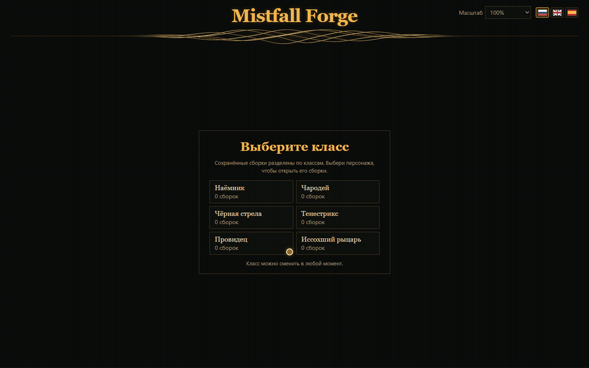
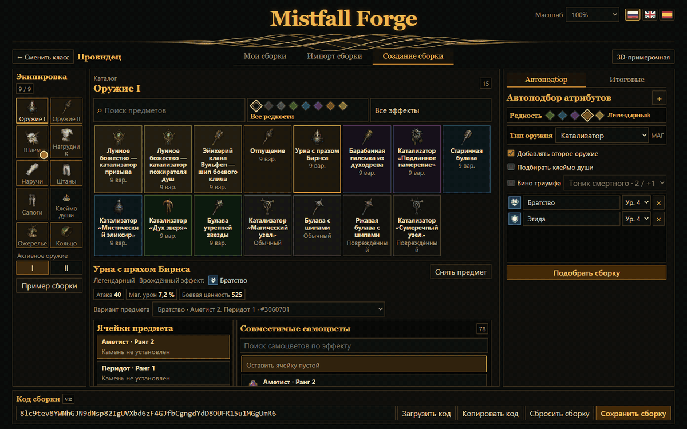
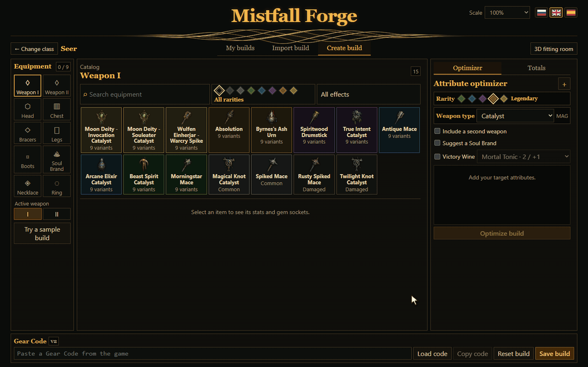

# Mistfall Forge

Редактор сборок для Mistfall Hunter на Windows. Импортируй Gear Code, меняй экипировку и самоцветы или попроси Forge подобрать комплект под нужные атрибуты.

**[Скачать для Windows](https://github.com/lReDragol/Mistfall-Build-Manager/releases/latest)** — распакуй ZIP целиком и запусти `MistfallForge.exe`. Для запуска нужен Microsoft Edge WebView2 Runtime. Русский, английский и испанский переключаются в шапке.

## Импорт и библиотека

Выбери класс, вставь Gear Code и проверь предметы и атрибуты. Сборку можно сразу открыть в редакторе или сохранить в «Мои сборки».



## Экипировка, самоцветы и Клеймо души

Выбери слот слева, чтобы открыть его каталог. Установи нужный самоцвет или настрой Клеймо души: оно находится справа от сапог и сохраняется отдельно от Gear Code.



## Автоподбор сборки

Укажи тип оружия и нужные атрибуты с уровнями. Forge покажет, какие цели выполнены, и сгенерирует Gear Code.



## 3D-примерочная

Посмотри, как экипировка выглядит на персонаже, и поверни модель мышью. Для просмотра нужны локальные GLB: игровые модели в ZIP не входят.


<details>
<summary>Сборка из исходников</summary>

Windows, .NET SDK 8+ и Node.js:

```powershell
npm.cmd ci --prefix desktop
npm.cmd run build --prefix desktop
dotnet run --project desktop/MistfallForge.csproj -c Release
```

</details>

[Лицензия MIT](LICENSE) · Названия и иллюстрации Mistfall Hunter принадлежат их правообладателям.
