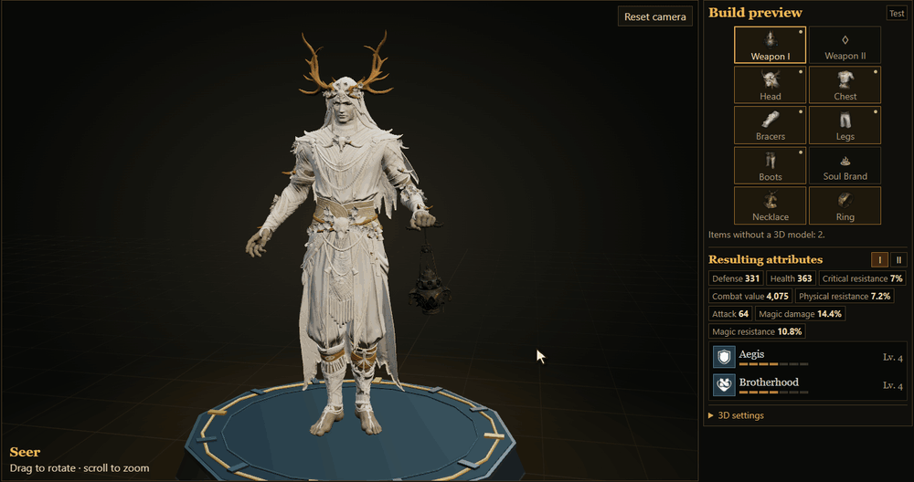

# Mistfall Forge

A Windows build editor for Mistfall Hunter. Import a Gear Code, change equipment and gems, or let Forge find a loadout that matches your target attributes.

**[Download for Windows](https://github.com/lReDragol/Mistfall-Build-Manager/releases/latest)** — extract the entire ZIP and run `MistfallForge.exe`. Requires Microsoft Edge WebView2 Runtime. Switch between English, Russian, and Spanish from the top bar.

## Import and save a build

Pick a class, paste a Gear Code, and review the equipment and attributes. Open the build in the editor or save it to **My builds**.


## Edit gear, gems, and Soul Brands

Select an equipment slot on the left to browse items and socket gems. The **Soul Brand** slot is next to Boots. Its settings are saved with the build, separately from the Gear Code.


## Optimize a build

Choose a weapon type, then add the attributes and levels you want. Forge shows which targets it matched and generates a Gear Code for the result.


## Preview equipment in 3D

Drag to rotate the character and scroll to zoom. The preview uses local GLB files; game models are not included in the download.



<details>
<summary>Build from source</summary>

Requires Windows, .NET SDK 8+, and Node.js:

```powershell
npm.cmd ci --prefix desktop
npm.cmd run build --prefix desktop
dotnet run --project desktop/MistfallForge.csproj -c Release
```

</details>

[MIT License](LICENSE) · Mistfall Hunter names and artwork belong to their respective owners.
